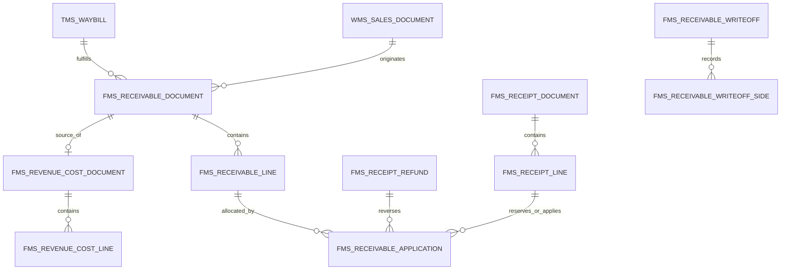

# 暂估应收与财务应收一体化设计

## 已确认的业务边界

- WMS 来源：已审核的销售出库单明细。SCM 销售订单仅作为上游追溯，不直接确认暂估。
- TMS 来源：已签收的运单。必须核对对应运输订单的签收证据；仅有 `completed` 状态而未签收的运单不能自动确认暂估。运输收入取订单应收 `total_fee`，运单只作履约证据；一个订单关联多运单时只确认一次，防止重复计入应收。
- 下推目标：财务应收单。需求文字中的“财务应付”为笔误。
- “收入成本确认”也是本次交付范围，应作为单独单据承载审核、收入与实际成本快照及凭证来源。
- 应收明细合同关联销售合同，需求中的“采购合同”为笔误。
- TMS 运费视为含税金额；来源没有税率，生成草稿后必须人工选择税率，未选择不能提交。
- FMS 是暂估应收、财务应收和冲回的账务主数据归属方。TMS、WMS 提供来源快照并引用 FMS 单据，不各建一份暂估台账。

## 数据归属

图中的单据名是概念边界；最终物理表以单头、明细、锁定/核销流水与必要索引组成，不把多行明细硬塞进一列，也不在 TMS 和 FMS 各维护一份可写的应收余额。

| 归属表 | 关键关联 | 权威字段与约束 |
| --- | --- | --- |
| `fms_receivable_document` / `line` | 单据类别、来源系统/ID、原暂估行、冲回触发行 | 编号按租户+类别+月唯一；已审核历史不可改；行与单头同租户 |
| `fms_receipt_document` / `line` | 财务应收行或独立入账交易 | 保存即锁定，确认后转核销；一笔交易不可重复生成收款 |
| `fms_receipt_refund` / `line` | 原收款及核销记录 | 退款总额不得超过原收款可退余额；确认付款追加反向流水 |
| `fms_receivable_application` | 财务应收行、来源单据行 | 区分发票、收款、坏账、冲销、调整、退款与勾稽；收款草稿只占用额度，确认后才计入已核销 |
| `fms_receivable_writeoff` / `side` | 双侧或特殊单侧来源 | 同组织、核销关系与权限检查；保存原币/本位币和汇兑损益；反核销留痕 |
| `fms_revenue_cost_document` / `line` | 暂估单与 WMS/TMS 实际成本来源 | 独立审核；来源限额；成本缺失阻止审核；原价和实际成本快照 |
| `mdm_receipt_condition` | 租户、收款计划与到期日 | 条件配置按租户隔离；已引用项不能直接删除 |

列表余额、锁定额、已关联额、未开票额与账龄均由上述明细和有效流水计算。必要时增加只读汇总视图或增量汇总，但不让可写汇总成为另一份账本。

以一套 `fms_receivable_document` 单头和 `fms_receivable_line` 明细承载三类单据：`estimate`、`financial`、`reversal`。来源类型和来源 ID 区分 WMS 销售出库、TMS 已签收运单、手工服务暂估。财务应收明细保存原暂估明细 ID、实际确认数量及金额、用于冲回的匹配数量或金额。冲回明细保存原暂估明细 ID 和触发冲回的财务应收明细 ID。单据编号计数器按租户、单据类别、年月唯一，数据库原子递增，月初从 001 开始。

财务应收允许两种合法来源：从已审核暂估下推，或“先开票”独立创建。独立先开票不产生暂估冲回，后续可与已审核销售来源及暂估行勾稽。单头维护结算组织、单据类型/状态、申请部门、初始化标识及凭证引用；核算状态、未核销额、已开票额、未开票额和未勾稽额均从审核后的关联事件计算，不接受客户端直接写余额。应收核销、应收调整、收款与退款、销售发票关联记录使用引用财务应收明细的附属流水，记录操作类型、来源单据、发生日期、审核状态和实际金额；它们不再各自持有一份权威应收余额。

收款单须有独立的草稿、提交、审核、确认收款状态。由财务应收下推保存草稿时即按明细锁定待核销额度；锁定不是核销，不减少应收余额。修改或删除未确认草稿时同步释放差额；同一应收行的可下推额度为“已审核应收 − 已核销 − 其他有效锁定”，数据库事务锁行并校验，阻止并发超占。确认收款时以同一事务将有效锁定转为核销流水并更新收款状态，重复确认保持幂等。出纳入账生成的收款单按租户、结算客户、币种、结算组织、来源或核销标识匹配；信息不足时保留未分配收款。手工核销和方案批量核销只能分配未占用的应收与未分配收款，保存匹配依据和操作者，支持后续联查与受控反核销。

退款以已确认收款的未退款余额为上限。财务应收的退款操作生成退款/付款草稿并引用原核销记录；审核和确认付款后形成反向资金与核销调整流水，不删除原收款和核销历史。付款申请只由已审核退款或贷方余额生成，保留独立审批与出纳付款状态。

手工核销工作台以结算组织、往来类型、往来单位、核销关系和核销日期为主轴。仅结束初始化的结算组织可用，主辅双方永不跨结算组织；“仅显示可核销数据”隐藏没有可用辅方单据的往来单位。六类关系分别是应收收款、应收冲应收、收款冲退款、应收退款、应收红蓝对冲和坏账收回。特殊核销允许单侧单据，但必须有经授权的业务原因、限额和独立凭证事件，不能把单侧操作伪装成双侧匹配。

核销记录以不可变单头和双侧分录保存关系类型、结算组织、核销日期、往来单位、币种、原币金额、本位币金额、换算方式、汇率及汇兑损益。默认匹配要求往来单位和币别相同；经权限选择“仅币别相同”时可跨往来单位，但仍不得跨组织；开启异币别核销时必须取核销日期的有效汇率并将汇兑损益单列，拒绝缺失或过期汇率。每笔核销在同一事务锁定双方可用余额、校验已锁定金额并写入记录；反核销追加反向记录，不删除原记录。手工方案仅提供匹配候选与规则校验，执行仍走同一核销事务。

工作台三项概览分别按所选组织和往来单位计算已审核财务应收未核销本位币、本月收款计划到期未核销本位币、已确认收款未分配本位币。客户切换与方案切换只影响同一权限范围内的候选与汇总。单据查验返回明确的状态、组织、币别、余额、锁定、汇率或权限阻断原因。

“冲销”“坏账损失”“质保金转回”须作为不同核销类型保留审计链；冲销需有可核对的对方应收/预收或调整来源，坏账须经过审核且留存原因，质保金转回按原质保金明细限额。付款申请只能基于已审核退款或贷方余额，不能直接由正向应收产生对外付款。财务应收统一按税率分组生成 FMS 发票管理中的普通/专用销项发票，保留原币和汇率，锁定来源客户、税率与金额。只有现有发票审批流程进入已开票状态才计入已开票额；作废或删除未提交草稿会释放开票关联。此类发票不再重复形成总账应收事件。原 WMS 原生销售发票流程保持独立。

单头持有租户、单据类别与类型、结算客户、付款客户、收款组织、项目、业务及记账日期、币种、收款条件、结算方式、来源单据、状态和凭证引用。明细持有物料或服务说明、单位、数量、原价、税率、折扣、金额、税额、价税合计、赠品、来源行及备注。金额型服务明细可无物料和数量；数量型商品明细必须有正数量。来源行、原暂估行、财务应收行均须与单头同租户。

`已关联财务应收`、`已开票数量`和`未关联金额`由未删除的财务应收明细聚合，不允许客户端直接反写。`已冲回`、`未冲回金额`和`完全勾稽`由已审核冲回明细聚合，不允许客户端设置开关。保存或删除财务应收草稿后，关联额立即变化；只有审核才产生冲回与正式应收发生额。

## 状态和冲回

| 单据类别 | 状态 | 允许迁移 | 账务影响 |
| --- | --- | --- | --- |
| 暂估应收 | 草稿 → 已提交 → 已审核 | 新建/保存、提交、审核；草稿可删除 | 审核后计入暂估应收 |
| 财务应收 | 草稿 → 已提交 → 已审核 | 从已审核暂估下推、修改实际数量/价格/税率、提交、审核；草稿可删除 | 审核后计入财务应收并原子生成冲回 |
| 暂估冲回 | 已审核 | 由财务应收审核自动生成，不允许手工修改或删除 | 按原暂估金额冲减暂估应收 |

每次审核财务应收时，按其匹配的暂估明细生成一张冲回单，日期采用财务应收业务日期。数量型按原暂估单价与本次匹配数量计算冲回金额，末次匹配吸收分位差；金额型按本次匹配金额冲回。部分审核形成部分冲回，原行完全匹配后才显示“已冲回”。实际财务应收单价或税率变化只改变财务应收金额，不改变原暂估冲回的计价基础。一次审核与冲回写入必须处于同一事务；重复审核不可重复冲回。并发审核锁定原暂估行，防止超额冲回。

含税折扣先从原价税额扣除，再按税率拆分折后未税金额和税额，保证 `金额 + 税额 = 价税合计`；赠品三项均为零。客户端预览采用同一规则，数据库以 `numeric` 最终复核，拒绝折扣超额与无效税率。财务应收实际数量超过未匹配暂估数量时，超额部分应另列未关联明细，不得冲回超出原暂估。

## 报表与凭证

应收明细与汇总分别按来源、客户、项目、业务日期、单据类别展示已审核暂估、冲回及财务应收发生额。暂估余额是已审核暂估减已审核冲回；正式应收余额另计，不能把两者简单相加当作同一债权。账龄以业务日期或收款条件推得的到期日为基准，展示未冲回暂估余额，并与原 TMS 客户对账应收分开标识，避免重复统计。金额字段沿用 FMS 敏感字段权限，不可借报表聚合绕过。

凭证预览和生成复用 FMS 科目、会计期间、自动过账规则和凭证中心。暂估确认、正式应收确认与暂估冲回是不同来源事件；生成请求必须幂等，凭证号由凭证中心回填。缺少账套、有效会计期间、科目映射时阻止生成并指出配置入口。打印用系统现有单据打印方式生成标准版，展示关键单头与明细、金额汇总和来源关系。

收入成本确认从已审核暂估应收下推，独立保存来源单据及明细快照。收入以经审核的暂估收入金额为基准；WMS 成本取出库对应库存移动的实际成本，TMS 成本取已审核的运单成本。审核时锁定来源与成本记录、核对租户和未确认数量/金额，防止同一来源重复确认；确认后的成本差异须用后续调整单追溯，不允许改写已审核历史。该单据与暂估应收的审核及财务应收冲回各自是独立账务事件，报表展示时避免重复确认收入。

## 租户和权限

普通用户只能读写认证租户。平台超级管理员在“全部租户”读全量，新建根单据默认其认证平台租户；已选具体租户时写入选中租户；从 WMS/TMS 来源或暂估下推时，目标租户继承来源单据。客户端租户 ID 只作请求意图，数据库检查来源、客户、组织、项目、物料、收款条件和相关行的租户一致性。读策略采用 `app_private.tenant_in_current_read_scope(tenant_id)`；写操作通过专用 RPC 检查页面按钮权限、单据状态、租户和来源条件。拒绝直接绕过状态机修改已审核单据。

## 交付检查

- WMS 已审核出库生成暂估；TMS 已签收运单按客户分别生成暂估；同一订单跨运单重复确认和与旧客户结算重复确认均被阻止。
- 保存财务应收草稿反映关联数量与金额；删除草稿恢复；部分审核按原价冲回，末次审核消除分位尾差；并发和重复审核不产生超额或重复冲回。
- 普通本租户、伪造跨租户头、平台全部租户、平台选中租户各做读写验证。
- 账龄、汇总和明细的暂估余额与原始单据、冲回记录对平；凭证预览与实生成一致。
- 列表、明细、空态、错误重试、窄屏、深色主题、焦点模式、打印与导出在真实浏览器中验证。

## 2026-10-22 数据库落地与验证

已通过项目 MCP 以直接事务方式写入 `ckbftoopuyophiebamwy`。未创建迁移或 runbook 文件。新增 15 张启用 RLS 的业务/配置表；业务金额以明细及有效应用流水为准。财务表禁止 authenticated 直接写入，所有业务 RPC 要求认证、按钮权限、租户及状态校验；私有辅助函数不可由 authenticated 调用。新增公开 RPC 均撤销 PUBLIC/anon 执行权限。平台写策略拆分为 INSERT/UPDATE/DELETE，并保留限制性租户读取策略，兼容平台全部租户和选中租户。

变更前保留完整 schema 及相关菜单、授权、编号、账套配置与被修改函数的定向 JSON 备份，位于忽略目录 `.artifacts/receivable-backup/`。旧数据导出空文件不作为恢复证据。修改现有发票及自动入账函数前逐项比对原定义；未覆盖期间的其他任务变更。正式落地没有写入测试应收、资金流水、试验汇率或期初余额。

自动数据库回归按以下顺序放入同一 `BEGIN` / `ROLLBACK` 事务运行；落地后已复跑通过：

1. `tests/integration/fms-receivable-fixtures.sql`：临时账套与期初测试上下文。
2. `fms-receivable-lifecycle.sql`：部分冲回、末次尾差与四种租户范围。
3. `fms-receivable-settlement.sql`：草稿占用/释放、确认收款、退款与付款申请幂等。
4. `fms-receivable-writeoff.sql`：调整、手工匹配、退款重开与反核销。
5. `fms-receivable-workbench.sql`：全部六类关系、特殊核销、查验、异币损益与贷方付款。
6. `fms-receivable-sources-invoice.sql`：真实 WMS/TMS 来源、多客户分组、已审核运输实际成本、发票草稿/开票/作废/删除联动。
7. `fms-receivable-voucher.sql`：临时规则下实际生成暂估、财务应收及反向冲回凭证，核对预览、借贷平衡和重复生成。
8. `fms-receivable-security.sql`：只读普通用户、隐藏金额、伪造范围、禁止正向应收付款和禁止匿名/直接写入。
9. `fms-receivable-line-balances.sql`：同一单据两行的金额、收款占用、暂估关联与冲回逐行核对；发票草稿、开票、作废及明细分页核对。

数据库建议项与变更前基线比较，已修复新增匿名执行与重复宽松读取策略提示。剩余新增项为 32 个经认证、权限和租户校验的 SECURITY DEFINER 业务入口提示，以及 39 个新表尚无业务数据的未使用索引信息；未以删索引或放开直接写权限消除提示。

客户端验证已通过：7 项金额模型单测、5 项业务路由单测、主项目与 FMS/MDM/TMS/WMS 类型检查、生产构建、ESLint、Stylelint、UI/权限/复用/数据库安全源代码审计。生产构建生成的版本化 `docs` 输出已恢复，避免把验收构建当作发布。浏览器使用真实组件和脱敏 API 数据，7 个案例覆盖窄屏、深色、空态、错误重试、8 个表格页面的专注模式、打印、编辑保存白名单、删除失败拦截及特殊核销；截图与打印 PDF 留在 `.artifacts/receivable-visual/`。已核对保存的设计参考与“角色与权限”实现。初轮登录态联调曾因浏览器控制工具的临时资源目录失效而未完成；该故障已修复，实际登录态验收见下文。

后续联合复验已在同一轮完整通过 7/7 个浏览器案例（4.3 分钟）、8 组数据库回滚测试、12 项金额与路由单测，以及应收相关类型检查。安全测试的取样已固定为已审核正向应收，另取已审核贷方应收，分别断言正向应收不能付款、只读角色不能创建贷方付款申请，避免依赖数据库行的偶然返回顺序。用户提供的真实内置浏览器截图已确认账号成功进入工作台；恢复控制后继续使用该账号完成了真实登录态业务页验收。

### 本次接续验收与余额修正

已补充实际登录态验收：从真实后端菜单进入暂估应收、财务应收、收款、退款、核销工作台、收入成本确认、应收汇总与账龄、应收付款申请，以及 MDM 财务主数据下的收款条件。列表查询与空态、暂估新增表单的默认参选资料、专注模式进入与 Esc 恢复均可正常工作，页面控制台未记录业务错误。此前“浏览器工具无法初始化”的限制已解除。真实收付款、审核及制证使用上述数据库回滚测试验收，没有为页面验收确认真实期初余额或写入真实账务。

修复按明细查询沿用整单余额的问题：服务端在明细分页后投影当前行的金额、税额、价税合计、已关联/未关联金额、已冲回/未冲回金额、未核销、收款占用及开票余额。列表、选中汇总与导出使用同一行投影，普通用户受限金额在单头和嵌套明细中继续返回空值。财务应收补充未关联销售发票价税合计、未勾稽金额、核销状态及申请部门；源行号和单据行号分别展示。

源单类型通过 `arSourceType` 字典展示销售出库单、运输运单、暂估应收单和财务应收单。字典属于现有应收业务目录，配置归平台租户，审计人按项目要求设置；没有在业务页内硬编码类型显示映射。

发票草稿和已开票流水占用销售发票关联额度；仅已开票流水减少未开票价税合计及未勾稽未税金额，作废或删除草稿恢复对应余额。未勾稽未税金额按各行未开票价税合计占比计算并逐行保留两位小数。已审核单据的提交、审核及删除按钮禁用，暂估冲回保持系统管理。

共享 `ArtTableQuery` 新增 `selection-details` 插槽，在保留默认数量与批量按钮的同时展示业务汇总，解决原 `header-left` 在选中状态下不渲染的问题。批量按钮按最新确认的项目样式紧跟已选数量靠左排列，金额汇总独占下一行，窄屏自动换行；浅色边框模式及深色阴影模式均保留完整金额与操作。原读取函数的恢复快照在 `.artifacts/receivable-backup/readers-before-line-balances.json`，变更经完整事务回滚测试后直接应用，随后九组数据库回归再次通过。

本次复验已通过主项目默认内存额度下的完整类型检查、FMS 类型检查、格式/ESLint/Stylelint、UI/权限/复用/数据库安全源码审计及项目快照校验。全仓单元测试分段覆盖全部文件；模块公共资源打包与组件命名审计曾在并行负载下超时，单独复跑均通过，未修改测试断言或超时上限。相关日志保存在忽略目录 `.artifacts/receivable-unit*.log`。

验证期间发现宿主依赖预构建扫描了大量历史预览、构建 HTML，并因其中已移动的组件引用而失败。宿主 `optimizeDeps.entries` 已明确指向真实应用入口 `index.html`；新增 `vite-dependency-entries.test.ts` 从 Vite 完整解析后的客户端配置验证真实入口和构建目录排除规则。应收浏览器最新一轮 8 个案例通过，包含两行余额合计、审核后禁用操作、深色阴影模式和窄屏、打印、删除检查失败拦截及特殊核销。新增源单类型已在实际登录态数据字典中核对四个启用值及 FMS → 应收款管理目录归属。

### 浏览器控制恢复与最终复核

经用户授权的短时 Windows 文件事件诊断定位到控制内核缓存的临时目录已被清理。仅重建该确切目录后，内置浏览器控制恢复；原始诊断记录与临时诊断脚本已清理。未更换账号、提取登录凭据或修改浏览器安全设置。

复核了同一登录会话下的 8 个应收业务页及 MDM 收款条件页：真实菜单和路由、后端查询完成后的空态、暂估与财务应收新增默认值、暂估专注模式及 Esc 恢复、明细与汇总账龄切换。最终控制台未记录业务警告或错误。无业务数据的登录态报表截图保存在 `.artifacts/receivable-visual/live-signed-in-report.jpg`，验收摘要已更新至原验证 JSON。核销页对本年期初尚未确认的默认账套继续正确阻止核销；资金确认、退款、审批与制证仍使用事务回滚回归证据，不为界面验收制造正式账务。

### 账套配置前提

核销要求当前默认账套的对应年度期初余额已确认。上线时业务租户现有确认记录属于旧非默认账套，新默认账套尚无已确认期初；系统将阻止核销并提示先维护期初。自动制证仍使用现有规则引擎；需要由财务按真实会计政策配置本次新增事件的科目、辅助核算及汇兑损益规则。系统不代填或确认真实期初余额，不擅自选择会计科目。汇兑损益正数表示损失，负数表示收益；收款、退款及贷方付款事件分别保留现金本位币、应收账面金额、未分配额和汇兑差额。
